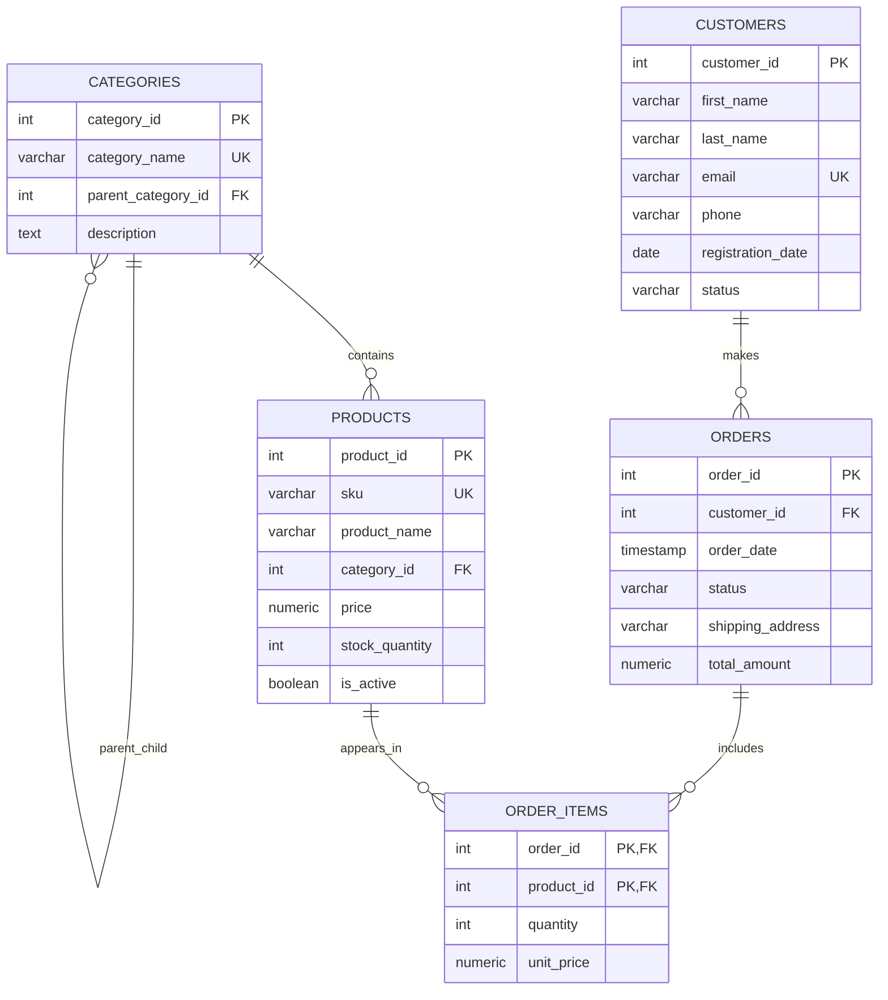

# Лабораторная работа №1. Проектирование и реализация реляционной базы данных

## Вариант 1. Интернет-магазин

## Краткое описание предметной области

Предметная область — интернет-магазин бытовой электроники и аксессуаров. В системе должны учитываться:
- клиенты и их контактные данные;
- категории товаров и их иерархия;
- товары, цены и остатки на складе;
- заказы клиентов и состав заказов;
- статусы заказов и адрес доставки.

База данных должна обеспечивать корректный учет продаж, контроль остатков товаров, сохранность данных и проверку ограничений целостности.

## Основные сущности и связи

1. Categories (категории товаров)
   - category_id
   - category_name
   - parent_category_id
   - description

2. Customers (клиенты)
   - customer_id
   - first_name
   - last_name
   - email
   - phone
   - registration_date
   - status

3. Products (товары)
   - product_id
   - sku
   - product_name
   - category_id
   - price
   - stock_quantity
   - is_active

4. Orders (заказы)
   - order_id
   - customer_id
   - order_date
   - status
   - shipping_address
   - total_amount

5. Order_items (позиции заказа)
   - order_id
   - product_id
   - quantity
   - unit_price

Связи:
- одна категория может иметь несколько дочерних категорий;
- один клиент может сделать несколько заказов;
- один заказ содержит несколько позиций;
- одна позиция относится к одному товару;
- один товар может встречаться в разных заказах.

## ER-диаграмма

## Описание основных проектных решений

### Первичные ключи
- Для всех самостоятельных сущностей используются surrogate keys (`SERIAL`).
- Для `order_items` используется составной первичный ключ `(order_id, product_id)`, так как одна и та же позиция товара не должна быть повторена в рамках одного заказа.

### Внешние ключи
- `products.category_id` -> `categories.category_id`
- `orders.customer_id` -> `customers.customer_id`
- `order_items.order_id` -> `orders.order_id`
- `order_items.product_id` -> `products.product_id`
- `categories.parent_category_id` -> `categories.category_id`

Выбраны правила:
- `ON DELETE RESTRICT` для сущностей, которые нельзя удалять, пока на них есть ссылки;
- `ON DELETE SET NULL` для родительской категории, чтобы сохранить дочерние категории без родителя;
- `ON DELETE CASCADE` для строк в `order_items`, потому что они являются частью заказа.

### Ограничения целостности
Использованы:
- `NOT NULL` для обязательных полей;
- `UNIQUE` для email клиента, SKU товара и имени категории;
- `CHECK` для допустимых значений цены, количества, статусов и суммы заказа;
- составной первичный ключ в `order_items`.

## Обоснование приведения к 3НФ

Модель соответствует 3NF, потому что:

1. Каждый атрибут зависит от первичного ключа.
   - Например, в `products` хранятся лишь свойства товара: артикул, название, цена, остаток, активность. Нет данных о клиенте или заказе.

2. Нет частичных зависимостей.
   - Значения в `order_items` зависят только от пары `(order_id, product_id)`, а не от одного поля.

3. Нет транзитивных зависимостей.
   - Название и описание категории хранятся только в таблице `categories`; они не дублируются в таблицах `products` или `orders`.

Поэтому модель не содержит избыточных данных и устойчиво поддерживает операции вставки, обновления и удаления.