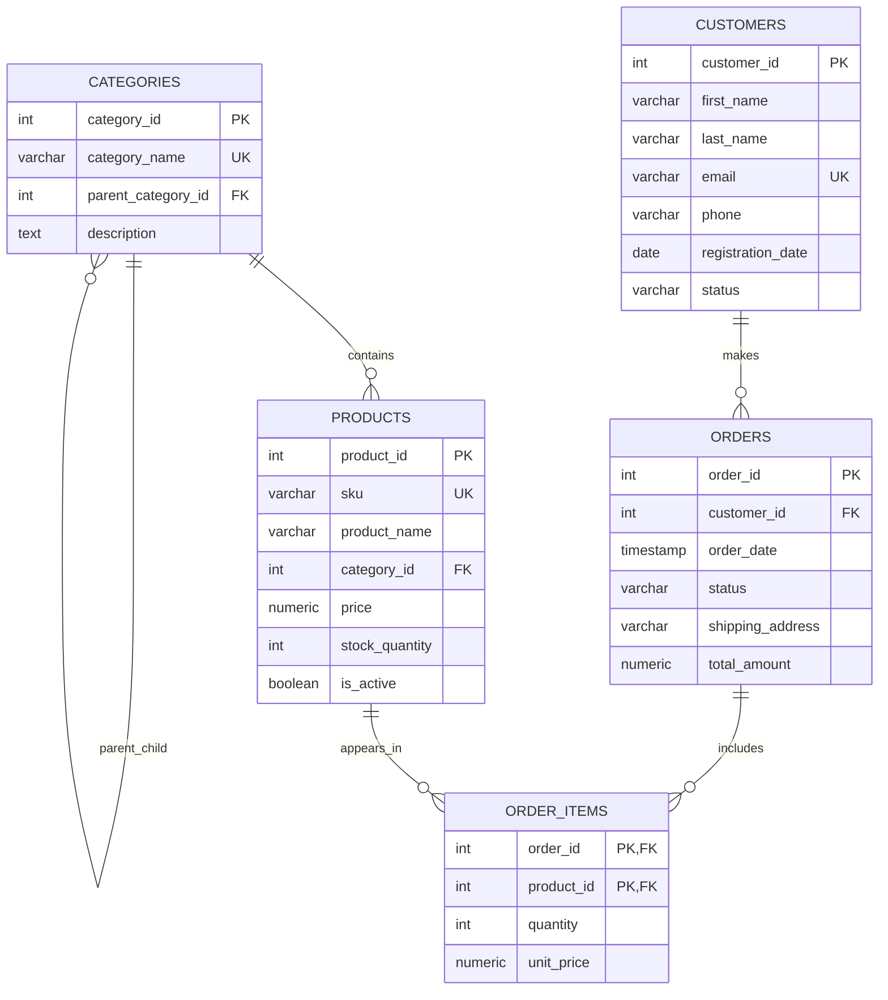

# Лабораторная работа №1. Проектирование и реализация реляционной базы данных

## Вариант 1. Интернет-магазин

## 1. Краткое описание предметной области

Предметная область — интернет-магазин бытовой электроники и аксессуаров. В системе должны учитываться:
- клиенты и их контактные данные;
- категории товаров и их иерархия;
- товары, цены и остатки на складе;
- заказы клиентов и состав заказов;
- статусы заказов и адрес доставки.

База данных должна обеспечивать корректный учет продаж, контроль остатков товаров, сохранность данных и проверку ограничений целостности.

## 2. Основные сущности и связи

1. Categories (категории товаров)
   - category_id
   - category_name
   - parent_category_id
   - description

2. Customers (клиенты)
   - customer_id
   - first_name
   - last_name
   - email
   - phone
   - registration_date
   - status

3. Products (товары)
   - product_id
   - sku
   - product_name
   - category_id
   - price
   - stock_quantity
   - is_active

4. Orders (заказы)
   - order_id
   - customer_id
   - order_date
   - status
   - shipping_address
   - total_amount

5. Order_items (позиции заказа)
   - order_id
   - product_id
   - quantity
   - unit_price

Связи:
- одна категория может иметь несколько дочерних категорий;
- один клиент может сделать несколько заказов;
- один заказ содержит несколько позиций;
- одна позиция относится к одному товару;
- один товар может встречаться в разных заказах.

## 3. ER-диаграмма



## 4. Принятые проектные решения

### 4.1. Первичные ключи
- Для всех самостоятельных сущностей используются surrogate keys (`SERIAL`).
- Для `order_items` используется составной первичный ключ `(order_id, product_id)`, так как одна и та же позиция товара не должна быть повторена в рамках одного заказа.

### 4.2. Внешние ключи
- `products.category_id` -> `categories.category_id`
- `orders.customer_id` -> `customers.customer_id`
- `order_items.order_id` -> `orders.order_id`
- `order_items.product_id` -> `products.product_id`
- `categories.parent_category_id` -> `categories.category_id`

Выбраны правила:
- `ON DELETE RESTRICT` для сущностей, которые нельзя удалять, пока на них есть ссылки;
- `ON DELETE SET NULL` для родительской категории, чтобы сохранить дочерние категории без родителя;
- `ON DELETE CASCADE` для строк в `order_items`, потому что они являются частью заказа.

### 4.3. Ограничения целостности
Использованы:
- `NOT NULL` для обязательных полей;
- `UNIQUE` для email клиента, SKU товара и имени категории;
- `CHECK` для допустимых значений цены, количества, статусов и суммы заказа;
- составной первичный ключ в `order_items`.

## 5. Обоснование приведения к 3НФ

Модель соответствует 3NF, потому что:

1. Каждый атрибут зависит от первичного ключа.
   - Например, в `products` хранятся лишь свойства товара: артикул, название, цена, остаток, активность. Нет данных о клиенте или заказе.

2. Нет частичных зависимостей.
   - Значения в `order_items` зависят только от пары `(order_id, product_id)`, а не от одного поля.

3. Нет транзитивных зависимостей.
   - Название и описание категории хранятся только в таблице `categories`; они не дублируются в таблицах `products` или `orders`.

Поэтому модель не содержит избыточных данных и устойчиво поддерживает операции вставки, обновления и удаления.

## 6. Структура файлов проекта

- `schema.sql` — создание структуры базы данных;
- `data.sql` — тестовые данные;
- `constraints_test.sql` — проверка ограничений целостности;
- `migration.sql` — дополнительное изменение структуры после реализации;
- `README.md` — описание проекта.

## 7. SQL-код: схема БД

Файл `schema.sql` содержит исходную структуру интернет-магазина.

### Содержательные таблицы
- `categories`
- `customers`
- `products`
- `orders`
- `order_items`

### Ограничения и типы PostgreSQL
- `SERIAL` для генерации идентификаторов;
- `VARCHAR` для строковых данных;
- `NUMERIC` для денежных сумм;
- `TIMESTAMP` для дат и времени заказов;
- `CHECK` для допустимых диапазонов значений числа и статусов.

## 8. Тестовые данные

Файл `data.sql` заполняет базу несколькими категориями, клиентами, товарами и заказами.

Пример:
- смартфоны и ноутбуки;
- несколько клиентов с разными статусами;
- товары с разными ценами и остатками;
- заказы с корректными суммами и позициями.

## 9. Проверка ограничений целостности

В `constraints_test.sql` предусмотрены намеренно некорректные операции, которые PostgreSQL должен отклонить.

Примеры проверок:
- повтор email клиента;
- повтор SKU товара;
- отрицательное количество товара на складе;
- нулевое количество позиции заказа;
- недопустимый статус заказа;
- отрицательная общая сумма заказа;
- ссылка на несуществующего клиента.

Каждый блок использует `DO $$ ... EXCEPTION ... $$` и фиксирует, что ошибка была корректно отклонена.

## 10. Дополнительное изменение предметной области

В соответствии с условием задания, после базовой реализации структура БД изменяется через `ALTER TABLE`, не пересоздавая базу данных. Это выполняется в `migration.sql`.

Дополнительные поля:
- `customers.loyalty_points` — число бонусных баллов клиента;
- `products.discount_percent` — процент скидки товара;
- `orders.delivery_type` — тип доставки (`standard`, `express`, `pickup`).

Миграция сохраняет существующие данные, добавляет новые атрибуты и проверяет их допустимые значения через `CHECK`.

## 11. Как запустить проект

```bash
psql -U postgres -d online_store_db -f schema.sql
psql -U postgres -d online_store_db -f data.sql
psql -U postgres -d online_store_db -f migration.sql
psql -U postgres -d online_store_db -f constraints_test.sql
```

Сначала создается база данных:

```sql
CREATE DATABASE online_store_db;
```

## 12. Итог

В результате реализована реляционная база данных интернет-магазина, удовлетворяющая требованиям лабораторной работы:
- более 5 содержательных таблиц;
- более 2 ограничений `UNIQUE`;
- более 3 ограничений `CHECK`;
- составной первичный ключ;
- обязательные поля с `NOT NULL`;
- логическая нормализация до 3НФ;
- данные и миграция сохранены при изменении модели.

Такой проект может использоваться как основа для следующих этапов разработки: корзины, оплаты, управления запасами и аналитики продаж.
